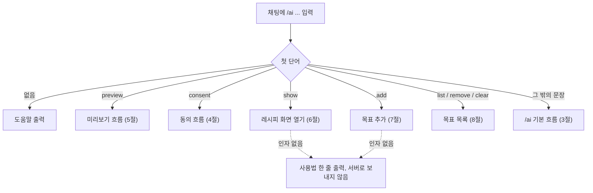
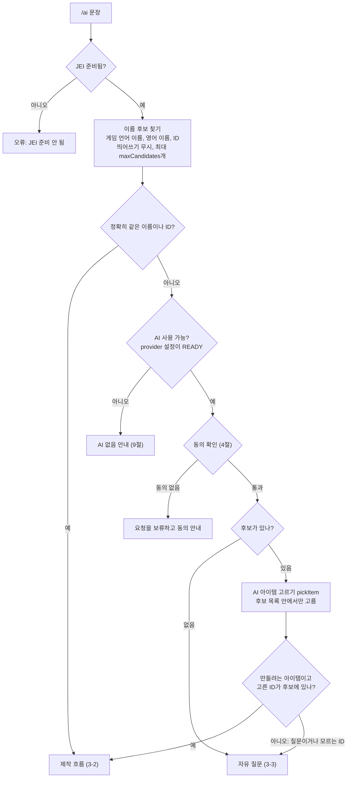
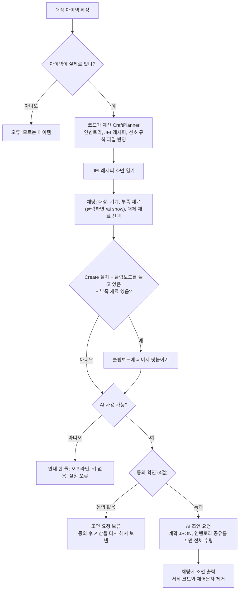
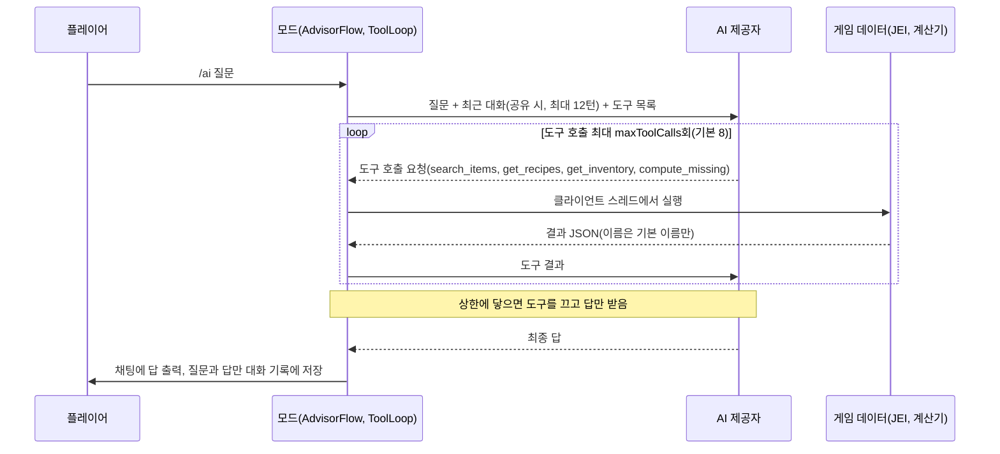
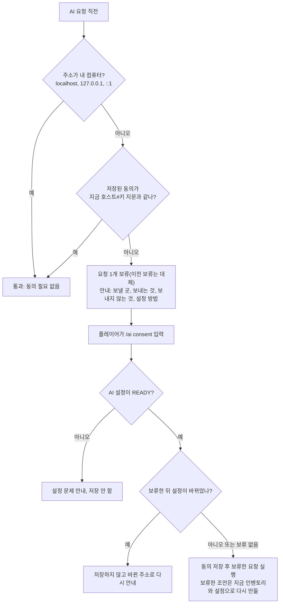
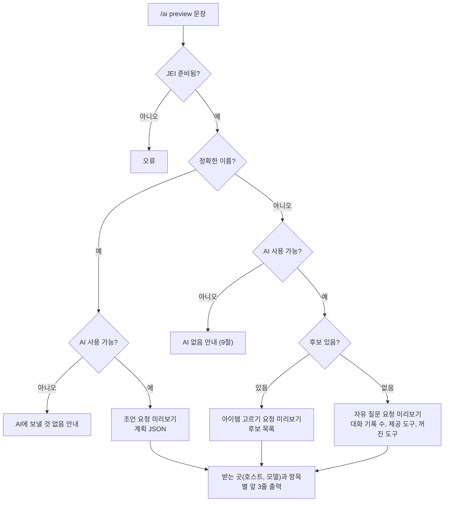
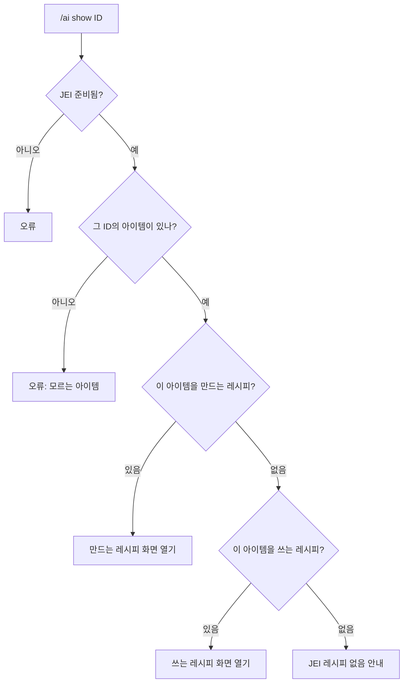
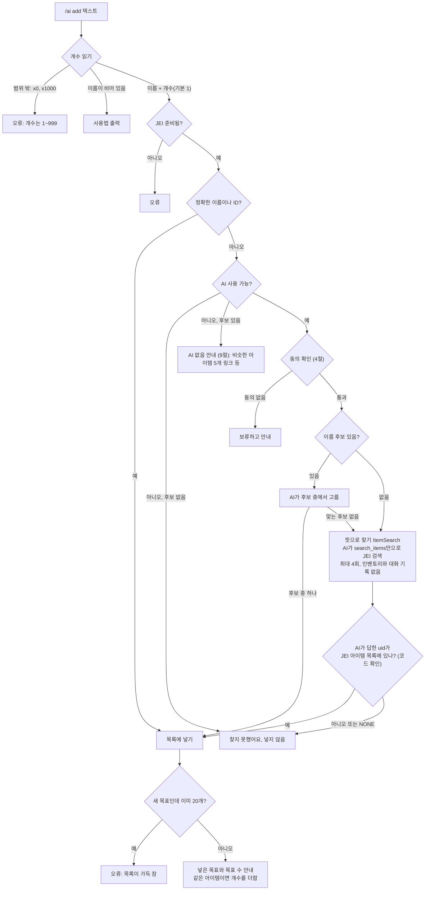
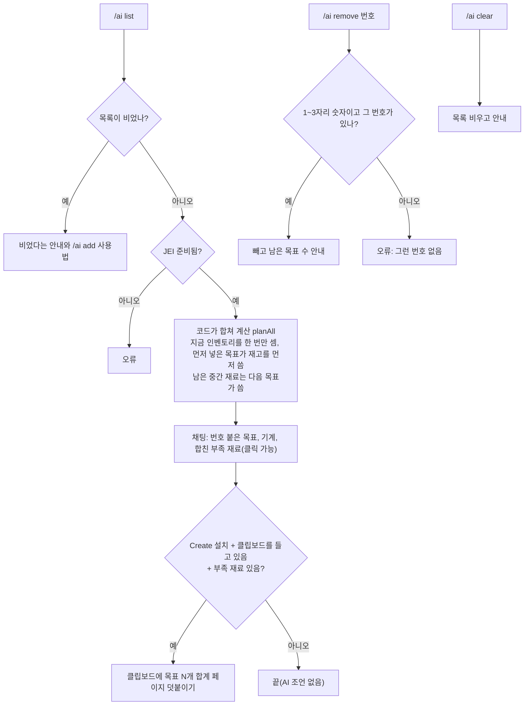

# 명령어와 작동 흐름

작성일: 2026-11-13 · 기준 코드: `feat/specs-01-03-07` 병합 시점(사양서 01~05, 07 1단계 반영)

`/ai`는 클라이언트 명령입니다. NeoForge가 내 컴퓨터에서 바로 실행하고 서버로 보내지 않습니다. 모든 명령은 채팅 창이 닫힌 다음 틱에 실행됩니다(`Minecraft.tell`). 그래서 명령이 연 JEI 화면이 채팅 창과 함께 닫히지 않습니다.

## 1. 명령어 목록

| 명령 | 하는 일 | AI 호출 | 코드 |
|---|---|---|---|
| `/ai` | 도움말 8줄 | 없음 | `AiCommand.help` |
| `/ai <아이템 또는 질문>` | 재료 계산, JEI 레시피, 클립보드, AI 조언, 또는 자유 질문 답 | 있을 수 있음 | `AdvisorFlow.start` |
| `/ai preview <문장>` | 위 명령이 AI에 보낼 내용을 미리 보여 줌. 보내지 않음 | 없음 | `AdvisorFlow.preview` |
| `/ai consent` | 현재 AI 주소로 보내는 것에 동의, 기다리던 요청 실행 | 기다리던 요청만 | `AdvisorFlow.consent` |
| `/ai show <아이템 ID>` | 그 아이템의 JEI 레시피 화면만 엶(채팅 링크가 사용) | 없음 | `ShowRecipe.show` |
| `/ai add <아이템> [x개수]` | 목표 목록에 추가 | 정확한 이름이 아닐 때만 | `GoalFlow.add` |
| `/ai list` | 목록 전체를 인벤토리 한 번으로 합쳐 계산 | 없음 | `GoalFlow.list` |
| `/ai remove <번호>` | 목록에서 하나 빼기 | 없음 | `GoalFlow.remove` |
| `/ai clear` | 목록 비우기 | 없음 | `GoalFlow.clear` |

개수는 `x4`, `×4`, `4개`로 쓰고 이름에 붙여 써도 됩니다(`피스톤x10`). 단 `x` 바로 앞이 영문자·숫자·`_`·`:`이면 이름의 일부로 봅니다. 개수 범위는 1~999입니다.

## 2. 명령 분기

`preview`, `consent`, `show`, `add`, `list`, `remove`, `clear`는 예약어입니다. 이 단어로 시작하는 문장은 질문이 아니라 하위 명령으로 처리됩니다.

## 3. `/ai <아이템 또는 질문>`

### 3-1. 아이템 찾기와 갈림길

OpenAI 호환 제공자에서 `pickItem` 답이 JSON 형식이 아니면 한 번 다시 요청합니다. 또 실패하면 질문으로 보고 자유 질문으로 넘어갑니다.

### 3-2. 제작 흐름 (계산은 코드, 판단은 AI)

### 3-3. 자유 질문 (도구 호출)

AI는 게임 데이터를 도구로만 봅니다. 도구 실행은 클라이언트 스레드에서 하고, AI 요청은 별도 스레드 하나에서 보냅니다.

- 인벤토리 공유(`shareInventory`)를 끄면 `get_inventory`는 제공하지 않고, `compute_missing`은 빈 인벤토리로 계산합니다.
- 대화 기록 공유(`shareHistory`)를 끄면 이전 대화를 보내지 않습니다.

## 4. 동의 확인과 `/ai consent`

AI 요청 직전에 항상 동의를 확인합니다. 동의 기록(`consentedHost`)에는 "호스트#키 지문"을 저장합니다. 그래서 모드팩이 설정 파일에 동의를 미리 써 두어도, 플레이어가 자기 키를 넣으면 다시 묻습니다.

## 5. `/ai preview <문장>`

`/ai <문장>`과 같은 길을 첫 AI 요청 직전까지 따라가서, 보낼 내용을 채팅에 보여 줍니다. 아무것도 보내지 않고, JEI도 열지 않습니다.

## 6. `/ai show <아이템 ID>`

채팅의 밑줄 친 재료 이름을 클릭하면 실행됩니다. 계산, 클립보드, AI 호출은 하지 않습니다.

유체 같은 아이템이 아닌 재료는 링크가 없습니다. `/ai show`는 아이템만 열 수 있습니다.

## 7. `/ai add <아이템> [x개수]`

목표를 넣기만 합니다. 계산, JEI 화면, 클립보드, AI 조언은 하지 않습니다. AI가 "질문"이라고 판단해도 자유 질문으로 넘기지 않습니다.

예: `/ai add 접착 피스톤x10`
1. 개수 10, 이름 "접착 피스톤"
2. 정확한 이름이 아님. 낱말 "피스톤"으로 피스톤 종류가 후보가 됨
3. AI가 후보 중 끈끈이 피스톤을 고르면 바로 추가됨. 맞는 후보가 없다고 하면 뜻으로 찾기에서 "sticky piston"을 검색함
4. 코드가 `minecraft:sticky_piston`이 실제 아이템인지 확인하고 10개를 추가함

## 8. `/ai list`, `/ai remove`, `/ai clear`

목록은 게임을 켜 둔 동안 메모리에만 있습니다. 게임을 끄면 사라집니다.

## 9. AI를 쓸 수 없을 때

`provider`, `baseUrl`, `apiKey`, `model` 설정을 다음 순서로 확인합니다. READY가 아니면 AI 요청을 만들지 않습니다.

| 상태 | 조건 | 아이템을 정확히 못 찾았을 때 | 제작 흐름 끝(조언 자리) |
|---|---|---|---|
| OFFLINE | `provider = offline` | 후보가 있으면 비슷한 아이템 5개 링크, 없으면 "오프라인 모드에서는 자유 질문을 쓸 수 없어요" | "오프라인 모드: AI 조언 없이…" |
| BAD_BASE_URL | `baseUrl`이 `https://`가 아님(내 컴퓨터 주소만 `http://` 허용), 또는 사용자 정보·쿼리·조각 포함 | 설정 오류 안내 | 설정 오류 안내 |
| NO_KEY | `anthropic`·`openai`인데 키가 비어 있음 | "정확히 일치하는 아이템이 없습니다…키를 넣으면…" + 비슷한 아이템 5개 링크 | "AI 조언을 받으려면…API 키를 넣으세요" |
| NO_MODEL | `anthropic`이 아닌데 `model`이 비었거나 기본값 그대로 | 모델 이름 설정 안내 | 모델 이름 설정 안내 |
| READY | 위에 해당 없음 | AI 사용(3, 7절) | AI 조언 |

`ollama`는 키가 없어도 READY가 될 수 있습니다. 기본 주소 `http://localhost:11434/v1`는 내 컴퓨터라서 동의도 묻지 않습니다.
